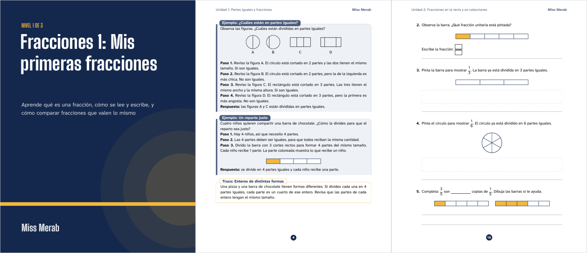
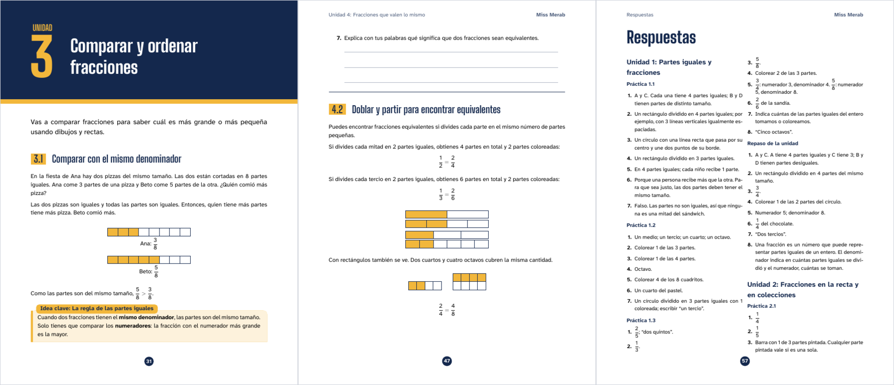

# Workbook Generator

Turn **a subject, a level, a language and a brand** into a print-ready student workbook (PDF), written by an LLM through [OpenRouter](https://openrouter.ai) and typeset with **LaTeX**, so math always renders correctly.

```sh
node src/cli.js --subject "Matemáticas / Fracciones" --level "1 of 3" --lang es_MX --brand miss-merab
```

→ a 60-page, 4-unit workbook with a branded cover, table of contents, lessons, worked examples, fraction diagrams, practice sets with room to write, unit reviews and an answer key. See the full example: [`examples/fracciones-nivel-1/fracciones-nivel-1.pdf`](examples/fracciones-nivel-1/fracciones-nivel-1.pdf).




---

## Contents

- [Features](#features)
- [Quick start](#quick-start)
- [How it works](#how-it-works)
- [CLI reference](#cli-reference)
- [Editing and re-running](#editing-and-re-running)
- [Branding](#branding)
- [Languages](#languages)
- [Choosing a model](#choosing-a-model)
- [The LaTeX template](#the-latex-template)
- [Project layout](#project-layout)
- [Testing](#testing)
- [Known limitations](#known-limitations)
- [License](#license)

## Features

- **One command, whole book.** Plans a multi-book series (e.g. "level 1 of 3"), then writes only *this* level's content, so books don't overlap.
- **Real typesetting.** Output is LaTeX compiled with `xelatex`: proper fractions, equations, and TikZ diagrams. Math digits use the same highly legible font as the text.
- **Built for children's workbooks.** Key-idea boxes, step-by-step worked examples, tips/common mistakes, auto-numbered practice sets (`Práctica 2.3`), a review per unit, answer lines, blanks, drawing boxes, and an answer key at the back.
- **Fraction visuals out of the box.** Bars, circles, grids and number lines drawn from one-line macros (`\wbfracbar{3}{4}`), so diagrams are accurate rather than hand-drawn by the model.
- **Grounded pedagogy.** Prompts require established, documented teaching approaches (concrete → pictorial → abstract, fraction strips, number lines, equal-sharing problems, bar models, worked examples with faded practice). No invented methods or mnemonics.
- **Self-checking.** Every unit gets a second "editor" pass that checks the math and the answer key, and every unit must compile on its own. LaTeX errors are fed back to the model to fix automatically.
- **Resumable and editable.** The plan and each unit are saved as plain files. Re-running reuses them, so you can hand-edit anything and rebuild in seconds without paying for model calls again.
- **Built from the teacher's own material.** `--source worksheet.pdf --source photo.jpg` reads PDFs (text, or scanned pages via the model's vision) and photos, and the plan and units follow that material's scope, sequence, notation and difficulty.
- **Teacher feedback loop.** `--revise "2: make it easier"` rewrites just that unit according to plain-language feedback (about a cent and 30 seconds), then recompiles.
- **Branding.** Name, colours and logo via a small JSON file or flags.
- **Any OpenRouter model.** Defaults to `typesafe/jev-router`; switch with `--model` or an env var.

## Quick start

**Requirements**

- Node.js 22+
- A TeX distribution with `xelatex` (TeX Live / MacTeX / BasicTeX)
- `poppler` (`pdftotext`, `pdftoppm`) only if you pass PDF `--source` files
- An [OpenRouter API key](https://openrouter.ai/keys)

**1. Install the LaTeX packages the template uses.** Full TeX Live / MacTeX already has them. On Debian/Ubuntu: `apt install texlive-xetex texlive-latex-extra texlive-pictures texlive-lang-spanish`. On **BasicTeX**, install them in user mode (no `sudo` needed):

```sh
tlmgr init-usertree
tlmgr --usermode install tcolorbox environ trimspaces pdfcol tikzfill enumitem titlesec needspace
```

**2. Configure your key.**

```sh
git clone https://github.com/johnparkerg/workbook-generator.git
cd workbook-generator
cp .env.example .env    # then put your OPENROUTER_API_KEY in .env
```

**3. Generate.**

```sh
npm run example         # Matemáticas / Fracciones · level 1 of 3 · es_MX · Miss Merab
# or
node src/cli.js --subject "Fractions" --level "1 of 3" --lang en_US --brand "Ms. Rivera"
```

The PDF lands in `output/<subject>-<level>-<lang>/<same>.pdf`. There are no npm dependencies to install.

## How it works

```
 subject, level, lang, brand
            │
            ▼
   1. PLAN ──────────────► plan.json         series split, audience (age/grade),
            │                                units → lessons → teaching approach
            ▼
   2. WRITE (per unit) ──► unit-N.draft.tex  LaTeX body + answer key,
            │                                using only the template's commands
            ▼
   3. REVIEW (per unit)                      editor pass: math, visuals vs. text,
            │                                answer key order, language
            ▼
   4. COMPILE CHECK ─────► unit-N.tex        xelatex; on error, the error and the
            │      ▲                         offending source lines go back to the
            │      └── fix (≤3×) ◄──┘        model to fix
            ▼
   5. ASSEMBLE ──────────► <slug>.pdf        cover, contents, units, answers
```

1. **Plan.** The model sketches how the whole subject divides across the N books of the series, sets the audience (it infers age and grade unless you pass `--audience`; for `es_MX` it aligns with the SEP curriculum), and plans this book's units and lessons. Each lesson names the documented teaching approach and visual models it will use.
2. **Write.** One call per unit (two units in parallel by default) produces the unit LaTeX and its answer key in a strict two-block format, restricted to the commands in [`templates/wb.sty`](templates/wb.sty).
3. **Review.** A second call acts as a meticulous editor and returns either `NO_CHANGES` or a fully corrected unit. Skip it with `--no-review`.
4. **Compile check.** Each unit is compiled by itself. If `xelatex` fails, the error message plus the surrounding source lines are sent back to the model, up to 3 times.
5. **Assemble.** Cover, name line, welcome page, table of contents, all units, and a two-column answer key, compiled until LaTeX stops asking for reruns.

Reasoning models spend output tokens on thinking. If a reply gets cut off, the call is retried automatically with double the token budget (up to 128k). Model usage and cost are printed at the end of each run.

## CLI reference

```
node src/cli.js --subject <text> [options]
```

| Option | Default | Description |
|---|---|---|
| `--subject <text>` | *required* | Subject and topic, e.g. `"Matemáticas / Fracciones"` |
| `--level <n[/m]>` | `1` | Level, e.g. `"1 of 3"`, `"1/3"`, `"1 de 3"` or `"2"` |
| `--lang <code>` | `es_MX` | `es_MX`, `es`, `en_US`, `en_GB`, `en`, `pt_BR`, `pt` |
| `--brand <name\|json>` | `Miss Merab` | A name to print, a file in `brands/` (`miss-merab`), or a path to a brand JSON |
| `--logo <file>` | | Logo for the cover (PNG/JPG/PDF) |
| `--primary`, `--secondary`, `--accent`, `--paper <#hex>` | | Override brand colours |
| `--units <n>` | `4` | Number of units (1–12) |
| `--audience <text>` | inferred | Age/grade, e.g. `"3.º de primaria"` |
| `--notes <text>` | | Extra instructions for the author model |
| `--source <file>` | | Teacher material to base the book on: PDF, PNG, JPG or WEBP (repeatable). Read once into `sources.md` |
| `--model <id>` | `$OPENROUTER_MODEL` or `typesafe/jev-router` | Any OpenRouter model id |
| `--max-tokens <n>` | `32000` | Starting output-token budget per call (doubles if cut off) |
| `--concurrency <n>` | `2` | Units written in parallel |
| `--no-review` | | Skip the editor pass (cheaper, less safe) |
| `--out <dir>` | `output/<slug>` | Output folder |
| `--plan-only` | | Stop after `plan.json` so you can review or edit it |
| `--plan-feedback <text>` | | Revise the saved `plan.json` following plain-language feedback |
| `--redo <list>` | | Rewrite these units from scratch, e.g. `--redo 2,4` |
| `--revise "<n>: <feedback>"` | | Revise a saved unit following teacher feedback, keeping everything else (repeatable) |
| `--force` | | Ignore everything saved and start over |

Environment (`.env`):

```sh
OPENROUTER_API_KEY=sk-or-...
OPENROUTER_MODEL=typesafe/jev-router   # optional default model
```

## Editing and re-running

Everything is saved in the run folder:

```
output/matematicas-fracciones-1de3-es-mx/
├── sources.md                # transcription of --source material (reused on re-runs)
├── plan.json                 # the outline (edit freely)
├── units/
│   ├── unit-1.draft.tex      # first draft, before review (kept for comparison)
│   └── unit-1.tex            # reviewed + compile-checked unit
├── workbook.tex              # the assembled document
├── build/                    # LaTeX build files and per-unit test PDFs
└── matematicas-fracciones-1de3-es-mx.pdf
```

Re-running the **same command** reuses whatever is saved, so a typical workflow is:

```sh
node src/cli.js ... --plan-only   # 1. get an outline
$EDITOR output/.../plan.json      # 2. tweak units/lessons
node src/cli.js ...               # 3. write the units
$EDITOR output/.../units/unit-2.tex   # 4. fix anything by hand
node src/cli.js ...               # 5. rebuild the PDF in seconds (no model calls)
node src/cli.js ... --revise "3: más ejemplos con dinero"   # targeted change to one unit (~$0.01)
node src/cli.js ... --redo 3      # or rewrite a unit from scratch
```

If you edit `plan.json` after units exist, use `--redo` for the affected units, since saved units are not rewritten automatically.

## Branding

`--brand` accepts a plain name (`"Profe Ana"`), the name of a JSON file in `brands/`, or a path to one:

```json
{
  "name": "Miss Merab",
  "logo": "logo.png",
  "colors": {
    "primary":   "#14284D",
    "secondary": "#4A5B7A",
    "accent":    "#F2B73B",
    "paper":     "#EEF1F6"
  }
}
```

- **primary**: cover, unit openers, practice boxes, page numbers
- **secondary**: worked examples, running header
- **accent**: highlights, key-idea boxes, shaded parts of fraction diagrams
- **paper**: soft backgrounds

`logo` is resolved relative to the JSON file. Typefaces are [Atkinson Hyperlegible Next](https://www.brailleinstitute.org/freefont/) for body text (designed for legibility) and [Big Shoulders Display](https://github.com/xotypeco/big_shoulders) for headings. Both are bundled in `fonts/` under the SIL Open Font License, so no TeX font packages are needed.

## Languages

| Code | babel | Notes |
|---|---|---|
| `es_MX` | `spanish, mexico` | Mexican conventions, decimal point; SEP-aligned planning |
| `es` | `spanish` | |
| `en_US`, `en_GB`, `en` | `american` / `british` / `english` | |
| `pt_BR`, `pt` | `brazilian` / `portuguese` | |

Interface labels (Unit, Practice, Answers, etc.) live in `src/config.js`. To add a language, add its labels and babel options there. Watch out for babel "shorthands" that make characters active and break TikZ (Spanish shorthands are disabled; French is not yet supported for this reason).

## Choosing a model

Any [OpenRouter model](https://openrouter.ai/models) works. The model must follow a strict output format and write valid LaTeX; the compile-and-fix loop catches most slips. For reference, the Fracciones example (plan + 4 units + 4 reviews) with `typesafe/jev-router` took about 13 minutes and cost about **$0.30**.

## The LaTeX template

[`templates/wb.sty`](templates/wb.sty) defines the whole look and a small vocabulary the model is allowed to use. The vocabulary is also documented in the prompt (`LATEX_VOCAB` in [`src/prompts.js`](src/prompts.js)).

| Command | Purpose |
|---|---|
| `\wbunit{Title}{Summary}` | Unit opener page (auto-numbered) |
| `\section{Lesson}` | Lesson heading (`1.2`, auto-numbered) |
| `wbidea`, `wbexample`, `wbtip` | Key idea, worked example, tip boxes (kept on one page) |
| `wbpractice` + `enumerate` | Practice set, auto-titled `Práctica <unit>.<k>`; pages only break *between* items |
| `wbreview` + `enumerate` | Unit review |
| `\wblines{n}`, `\wbblank`, `\wbbox[h]`, `\wbfracbox` | Answer space: ruled lines, inline blank (a box inside math), drawing box, empty fraction |
| `\wbfracbar[w]{n}{d}` | Bar split into *d* equal parts, *n* shaded |
| `\wbfraccircle[r]{n}{d}` | Circle split into *d* sectors, *n* shaded |
| `\wbfracgrid{n}{rows}{cols}` | Grid with *n* cells shaded |
| `\wbnumberline[w]{d}{wholes}{marks}` | Number line 0…wholes in *d* parts per whole, with marked points |
| `\wbanswers{…}`, `wbanswerkey` | Answer-key structure |

Other diagrams can be drawn with plain TikZ using the brand colours `wbprimary`, `wbsecondary`, `wbaccent` and `wbpaper`.

## Project layout

```
src/
  cli.js          argument parsing, entry point
  generate.js     pipeline: plan → write → review → compile-check → assemble
  prompts.js      all prompts, the LaTeX vocabulary, output parsing/normalising
  openrouter.js   OpenRouter client (retries, token-budget doubling, usage/cost)
  latex.js        document assembly, xelatex runner, log → readable errors
  sources.js      teacher material (PDF text / vision transcription) → sources.md
  config.js       languages, labels, brands, level parsing, .env loading
templates/wb.sty  the workbook style (layout, boxes, visuals, cover)
brands/           brand JSON files
fonts/            bundled body and heading fonts (SIL OFL)
examples/         a complete generated example (plan, units, PDF)
test/             unit tests + a hand-written fixture unit
```

## Testing

```sh
npm test
```

Covers level/language/brand parsing, LaTeX escaping, model-output parsing and normalisation, a real `xelatex` compile of a fixture unit, and that compile errors are reported with the offending source line.

## Known limitations

- **Model-drawn diagrams aren't visually verified.** The review pass checks the text and LaTeX, not the rendered picture, so a custom TikZ figure can contradict its caption (e.g. "unequal parts" drawn nearly equal). The built-in fraction macros are always accurate. Review the PDF before printing.
- **Proofread before classroom use.** The review pass catches most errors, but this is generated content.
- **Unbreakable boxes** keep examples and practice items whole, which can leave white space at the bottom of some pages.
- **Paper size** is US Letter (`templates/wb.sty`, `\geometry{letterpaper…}`).

## License

Code: [MIT](LICENSE). Fonts: SIL Open Font License 1.1 ([Atkinson Hyperlegible Next](fonts/OFL-Atkinson.txt), [Big Shoulders Display](fonts/OFL-BigShoulders.txt)). The example workbook in `examples/` was generated with this tool for the "Miss Merab" brand.
